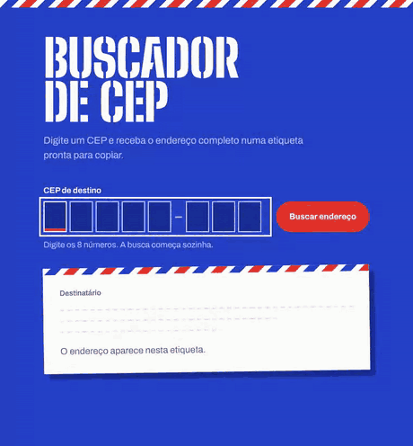

<div align="center">

# Buscador de CEP

Digite um CEP e receba o endereço completo numa etiqueta de envio, pronta para copiar.

**[Abrir o buscador →](https://buscador-de-cep-omega-green.vercel.app/)**



</div>

## O que ele faz

- **Campo em quadradinhos**, como nos formulários de correio. Aceita colar o CEP com ou sem traço, e a busca começa sozinha no 8º número.
- **Etiqueta de envio** com rua, complemento, bairro, cidade, DDD e código IBGE. O código de barras é gerado a partir do próprio CEP (padrão POSTNET), e um carimbo postal com a cidade e a data "bate" na etiqueta quando o endereço chega.
- **Copiar endereço** em uma linha e **ver no mapa** (Google Maps).
- **Últimos CEPs buscados** salvos no navegador, para buscar de novo com um clique.
- **Erros explicados na tela**: CEP incompleto, CEP que não existe e falha de conexão têm mensagens diferentes.
- Funciona no celular, com teclado numérico, e respeita quem desativa animações no sistema.

<table>
  <tr>
    <td></td>
    <td width="32%"></td>
  </tr>
</table>

## Tecnologias

- [React 18](https://react.dev) (Create React App)
- [Axios](https://axios-http.com) para as requisições
- [ViaCEP](https://viacep.com.br), API pública e gratuita de CEPs
- CSS puro, com as fontes [Big Shoulders Stencil](https://fonts.google.com/specimen/Big+Shoulders+Stencil+Display) e [Archivo](https://fonts.google.com/specimen/Archivo) embutidas pelo [Fontsource](https://fontsource.org)

## Como rodar

```bash
git clone https://github.com/fabionasc1mento/buscadordecep.git
cd buscadordecep
npm install
npm start
```

Abre em `http://localhost:3000`. Para gerar a versão de produção: `npm run build`.

## Organização do código

```
src/
├── services/
│   ├── api.js            # cliente HTTP do ViaCEP
│   └── cepService.js     # regras do CEP (validar, formatar) e busca do endereço
├── hooks/
│   ├── useCepSearch.js   # estado da busca: carregando, encontrado, não existe, erro
│   └── useRecentCeps.js  # últimos CEPs, salvos no localStorage
├── components/
│   ├── CepInput.jsx      # campo em quadradinhos
│   ├── AddressLabel.jsx  # etiqueta com o endereço
│   ├── Barcode.jsx       # código de barras gerado do CEP
│   ├── Postmark.jsx      # carimbo postal
│   └── RecentCeps.jsx    # lista dos últimos buscados
├── App.js                # junta tudo e cuida das mensagens
└── style.css
```

Os componentes não conversam com a API direto: pedem o endereço ao `cepService`, que valida o CEP, chama o ViaCEP e devolve um objeto já organizado. Assim, trocar de API mexe em um arquivo só.

---

Feito por [Fábio Tarcio](https://fabionasc1mento.github.io).
